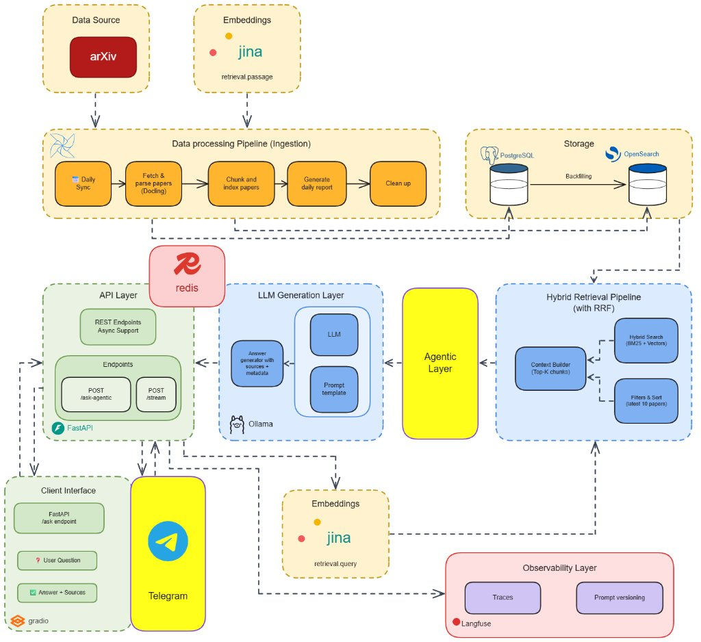
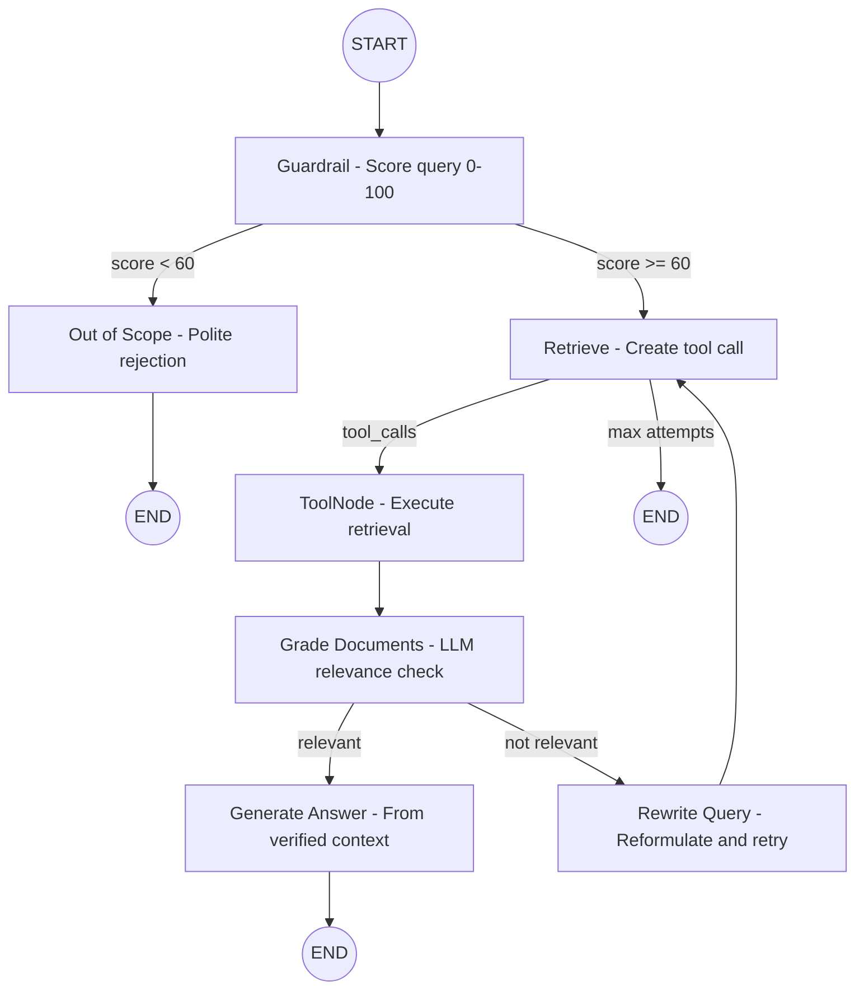

# 📚 arXiv Paper Curator

**A production-grade Agentic RAG system for intelligent research paper discovery and question answering.**

> An end-to-end system that ingests, indexes, and answers questions about CS/AI research papers from arXiv — powered by hybrid search, an agentic LangGraph workflow with self-correcting retrieval, and multiple client interfaces including a Telegram bot and web UI.

---

## 📋 Table of Contents

- [Problem Statement](#-problem-statement)
- [Architecture](#-architecture)
- [Key Features](#-key-features)
- [System Components](#-system-components)
  - [Data Ingestion Pipeline](#1-data-ingestion-pipeline)
  - [Hybrid Retrieval Engine](#2-hybrid-retrieval-engine)
  - [RAG Generation Layer](#3-rag-generation-layer)
  - [Agentic RAG with LangGraph](#4-agentic-rag-with-langgraph)
  - [Observability & Caching](#5-observability--caching)
  - [Client Interfaces](#6-client-interfaces)
- [API Reference](#-api-reference)
- [Project Structure](#-project-structure)
- [Tech Stack](#-tech-stack)
- [Getting Started](#-getting-started)
- [Configuration](#-configuration)
- [License](#-license)

---

## 🎯 Problem Statement

Keeping up with the rapidly growing body of academic research in Computer Science and Artificial Intelligence is a significant challenge. Researchers, students, and practitioners face several pain points:

1. **Information Overload** — Thousands of new papers are published on arXiv every week in CS/AI alone. Manually scanning titles, abstracts, and full papers is unsustainable.

2. **Fragmented Discovery** — Finding relevant papers requires jumping between arXiv, Google Scholar, Semantic Scholar, and Twitter/X. There is no single system that ingests, indexes, and lets you *ask questions* about the papers in natural language.

3. **Shallow Search** — Keyword search alone misses semantically related papers. A query for "attention mechanisms" won't necessarily surface papers about "self-attention in vision transformers" unless the exact words match.

4. **No Conversational Interface** — Existing tools return lists of papers, not answers. Researchers want to ask "How does LoRA reduce fine-tuning costs?" and get a synthesized answer *with citations* — not a ranked list of PDFs.

5. **Lack of Quality Assurance** — Naive RAG systems retrieve chunks blindly and generate answers from potentially irrelevant context, leading to hallucinations and low-quality responses.

**arXiv Paper Curator** solves all five problems with a production-grade pipeline:

- **Automated ingestion** fetches, parses (via Docling), chunks, and indexes papers daily.
- **Hybrid search** (BM25 + dense vectors via Jina AI) captures both lexical and semantic relevance, fused with Reciprocal Rank Fusion (RRF).
- **Agentic RAG** (via LangGraph) doesn't just retrieve-and-generate — it *validates* query scope, *grades* retrieved documents, *rewrites* queries when context is insufficient, and only generates answers from verified, relevant chunks.
- **Multi-channel access** through REST API, Gradio web UI, and Telegram bot.
- **Full observability** via Langfuse tracing and prompt versioning, with user feedback loops for continuous improvement.

---

## 🏗 Architecture

<p align="center">
  
</p>

The system is composed of six major layers:

| Layer | Components | Purpose |
|-------|-----------|---------|
| **Data Source** | arXiv API + Jina Embeddings | Fetch papers and generate passage embeddings |
| **Ingestion Pipeline** | Docling parser, text chunker, hybrid indexer | Parse PDFs, chunk text, index into OpenSearch |
| **Storage** | PostgreSQL + OpenSearch | Metadata storage + full-text/vector search |
| **Retrieval Pipeline** | BM25 + vector search + RRF | Hybrid retrieval with reciprocal rank fusion |
| **LLM Generation** | Ollama (Llama 3.2) + Agentic Layer (LangGraph) | Intelligent answer generation with self-correction |
| **Client Interfaces** | FastAPI + Gradio + Telegram | REST API, web chat, and mobile messaging |
| **Observability** | Langfuse + Redis | Tracing, prompt versioning, and query caching |

---

## ✨ Key Features

### 🔍 Intelligent Search
- **Hybrid Search** — Combines BM25 keyword matching with 1024-dimensional Jina AI dense vector search
- **Reciprocal Rank Fusion (RRF)** — Merges lexical and semantic results for superior retrieval quality
- **Configurable top-k** and category filters for precision control

### 🤖 Agentic RAG (Self-Correcting)
- **Guardrail Node** — LLM-scored query validation (0-100) rejects off-topic queries before wasting retrieval resources
- **Document Grading** — LLM grades each retrieved chunk as relevant/irrelevant with reasoning
- **Query Rewriting** — If retrieved context is poor, the agent autonomously rewrites the query and retries (up to 2 attempts)
- **Transparent Reasoning** — Every response includes the agent's decision-making steps

### 📊 Production Observability
- **Langfuse Integration** — Full trace capture for every request: retrieval latency, LLM calls, grading decisions
- **Prompt Versioning** — Track and iterate on prompt templates
- **User Feedback Loop** — `POST /feedback` endpoint records user satisfaction scores linked to traces

### ⚡ Performance
- **Redis Caching** — Exact-match query cache with configurable TTL (default: 6 hours)
- **Streaming Responses** — Server-Sent Events (SSE) for real-time token-by-token output
- **Async Throughout** — Fully async FastAPI application with non-blocking I/O

### 📱 Multi-Channel Access
- **REST API** — Full-featured endpoints for programmatic access
- **Gradio Web UI** — Interactive chat interface at `/chat`
- **Telegram Bot** — Ask questions and search papers directly from Telegram

---

## 🔧 System Components

### 1. Data Ingestion Pipeline

The ingestion pipeline runs as a daily automated workflow that keeps the knowledge base fresh.

```
arXiv API → Fetch Papers → Parse PDFs (Docling) → Chunk Text → Generate Embeddings → Index to OpenSearch
                                                                                    → Store metadata in PostgreSQL
```

| Component | File | Description |
|-----------|------|-------------|
| **arXiv Client** | `services/arxiv/client.py` | Fetches papers from arXiv API with rate limiting and retry logic |
| **PDF Parser** | `services/pdf_parser/docling.py` | Extracts structured text from PDFs using Docling with section awareness |
| **Text Chunker** | `services/indexing/text_chunker.py` | Semantic chunking (600 tokens, 100 overlap) preserving section boundaries |
| **Hybrid Indexer** | `services/indexing/hybrid_indexer.py` | Indexes chunks with both text and dense vector representations |
| **Jina Embeddings** | `services/embeddings/jina_client.py` | Generates 1024-dimensional embeddings via Jina AI `retrieval.passage` model |

**Chunking Strategy:**
```
┌─────────────────────────────────────────────┐
│ Full Paper (Docling-parsed)                 │
├──────────┬──────────┬──────────┬────────────┤
│ Abstract │ Section1 │ Section2 │ ...        │
├──────────┼──────────┼──────────┼────────────┤
│ Chunk 1  │ Chunk 2  │ Chunk 3  │ Chunk N    │
│ (600tok) │ (600tok) │ (600tok) │ (≥100tok)  │
│          │ ←100tok→ │ ←100tok→ │            │  ← overlap
└──────────┴──────────┴──────────┴────────────┘
```

### 2. Hybrid Retrieval Engine

The retrieval system combines two complementary search strategies using OpenSearch:

| Strategy | Strength | Example |
|----------|----------|---------|
| **BM25 (Lexical)** | Exact keyword matches | "BERT" → finds papers mentioning BERT |
| **Dense Vector (Semantic)** | Meaning-based similarity | "language understanding" → finds BERT papers |
| **RRF Fusion** | Best of both | Merges rankings with `1/(k + rank)` formula |

```python
# OpenSearch hybrid query pipeline
{
    "search_pipeline": "hybrid-rrf-pipeline",
    "query": {
        "hybrid": {
            "queries": [
                {"match": {"chunk_text": query}},          # BM25
                {"knn": {"embedding": {"vector": [...]}}}  # Vector
            ]
        }
    }
}
```

### 3. RAG Generation Layer

The standard RAG pipeline (`POST /ask`) follows a straightforward retrieve-then-generate pattern:

1. **Embed** the user query using Jina AI (`retrieval.query` model)
2. **Search** OpenSearch with hybrid BM25 + vector query
3. **Build** prompt with retrieved chunks as context
4. **Generate** answer via Ollama (Llama 3.2:1b)
5. **Cache** the response in Redis for future identical queries

### 4. Agentic RAG with LangGraph

The agentic endpoint (`POST /ask-agentic`) adds an intelligent decision-making layer using LangGraph:



**6 Agent Nodes:**

| Node | Purpose | Output |
|------|---------|--------|
| **Guardrail** | Scores query relevance (0-100) via structured LLM output | Route to retrieve or reject |
| **Out of Scope** | Generates polite rejection for off-topic queries | Final message |
| **Retrieve** | Creates tool call with the user's (possibly rewritten) query | Tool invocation |
| **Grade Documents** | LLM grades each chunk as relevant/irrelevant with reasoning | Route to generate or rewrite |
| **Rewrite Query** | LLM reformulates the query for better retrieval | New query → retry |
| **Generate Answer** | Produces final answer from verified relevant context only | Final answer |

**Key Design Decisions:**
- **`context_schema`** — Dependencies (Ollama, OpenSearch, embeddings clients) are injected via LangGraph's `Runtime[Context]`, keeping nodes as pure functions
- **Structured Output** — Guardrail, grading, and rewriting use Pydantic models with `with_structured_output()` for reliable JSON responses
- **Max 2 retries** — The rewrite→retrieve loop runs at most 2 times to prevent infinite loops

### 5. Observability & Caching

#### Langfuse Tracing
Every request is traced end-to-end with Langfuse:

```
Trace: agentic_rag_request
├── Span: guardrail_check (score: 92/100)
├── Span: document_retrieval (3 chunks)
├── Span: document_grading (2 relevant, 1 irrelevant)
└── Span: answer_generation (tokens: 342)
```

#### Redis Caching
- **Exact-match** query caching using normalized query strings as keys
- **Configurable TTL** (default: 6 hours)
- **Graceful degradation** — Application works without Redis (caching is optional)

#### User Feedback
```json
POST /api/v1/feedback
{
    "trace_id": "abc-123",
    "score": 1.0,
    "comment": "Accurate answer with great sources"
}
```
Feedback is linked to Langfuse traces for quality monitoring.

### 6. Client Interfaces

#### REST API (FastAPI)
Full-featured async API with Swagger documentation at `/docs`.

#### Gradio Web UI
Interactive chat interface mounted at `/chat` — ask questions and get answers with source citations in a conversational UI.

#### Telegram Bot
Message-based interface for mobile access:
- `/start` — Welcome and onboarding
- `/help` — Usage examples
- `/search <keywords>` — Search papers (hybrid search, deduplicated results)
- **Any text message** — Routed through the RAG pipeline with caching

---

## 📡 API Reference

| Method | Endpoint | Description |
|--------|----------|-------------|
| `GET` | `/api/v1/health` | Health check with service status |
| `POST` | `/api/v1/search/` | BM25 keyword search |
| `POST` | `/api/v1/hybrid-search/` | Hybrid BM25 + vector search |
| `POST` | `/api/v1/ask` | Standard RAG Q&A (cached) |
| `POST` | `/api/v1/stream` | Streaming RAG via SSE |
| `POST` | `/api/v1/ask-agentic` | Agentic RAG with guardrail + grading + rewriting |
| `POST` | `/api/v1/feedback` | Submit user feedback on responses |
| `GET` | `/chat` | Gradio web UI |
| `GET` | `/docs` | Swagger API documentation |

### Example: Agentic RAG Request

```bash
curl -X POST http://localhost:8000/api/v1/ask-agentic \
  -H "Content-Type: application/json" \
  -d '{
    "query": "How does LoRA reduce fine-tuning costs?",
    "top_k": 3,
    "use_hybrid": true
  }'
```

**Response:**
```json
{
    "query": "How does LoRA reduce fine-tuning costs?",
    "answer": "LoRA (Low-Rank Adaptation) reduces fine-tuning costs by freezing the pre-trained model weights and injecting trainable low-rank decomposition matrices into each layer of the Transformer architecture. Instead of updating all parameters, LoRA only trains two small matrices A and B where the weight update ΔW = BA...",
    "sources": [
        "https://arxiv.org/pdf/2106.09685.pdf"
    ],
    "chunks_used": 3,
    "search_mode": "hybrid",
    "reasoning_steps": [
        "Validated query scope (score: 95/100)",
        "Retrieved documents (1 attempt(s))",
        "Graded documents (2 relevant)",
        "Generated answer from context"
    ],
    "retrieval_attempts": 1,
    "trace_id": "abc123-def456-ghi789"
}
```

---

## 📂 Project Structure

```
arxiv-paper-curator/
├── compose.yml                    # Docker Compose (7 services)
├── Dockerfile                     # API container build
├── Makefile                       # Developer commands
├── pyproject.toml                 # Dependencies (uv)
├── .env.example                   # Environment template
│
├── docs/
│   └── architecture.jpg           # System architecture diagram
│
├── src/
│   ├── main.py                    # FastAPI app + lifespan
│   ├── config.py                  # Pydantic settings (9 config classes)
│   ├── dependencies.py            # FastAPI dependency injection (11 deps)
│   ├── database.py                # Database initialization
│   ├── gradio_app.py              # Gradio chat UI
│   │
│   ├── db/                        # Database layer
│   │   ├── interfaces/
│   │   │   ├── base.py            # Abstract database interface
│   │   │   └── postgresql.py      # PostgreSQL implementation
│   │   └── factory.py             # Database factory
│   │
│   ├── models/
│   │   └── paper.py               # SQLAlchemy Paper model
│   │
│   ├── repositories/
│   │   └── paper.py               # Paper CRUD repository
│   │
│   ├── schemas/                   # Pydantic schemas
│   │   ├── api/                   # Request/response models
│   │   │   ├── ask.py             # AskRequest, AskResponse, AgenticAskResponse
│   │   │   ├── health.py          # HealthResponse
│   │   │   └── search.py          # SearchRequest, SearchResponse
│   │   ├── arxiv/paper.py         # ArxivPaper, PaperCreate
│   │   ├── embeddings/jina.py     # Jina API schemas
│   │   ├── indexing/models.py     # TextChunk, ChunkMetadata
│   │   └── pdf_parser/models.py   # ParsedPaper, PaperSection
│   │
│   ├── routers/                   # API endpoints
│   │   ├── ping.py                # GET  /health
│   │   ├── search.py              # POST /search
│   │   ├── hybrid_search.py       # POST /hybrid-search
│   │   ├── ask.py                 # POST /ask, /stream, /feedback
│   │   └── agentic_ask.py         # POST /ask-agentic
│   │
│   └── services/                  # Business logic
│       ├── arxiv/                 # arXiv API client
│       ├── pdf_parser/            # Docling PDF parser
│       ├── embeddings/            # Jina AI embeddings
│       ├── indexing/              # Text chunking + hybrid indexing
│       ├── opensearch/            # Search engine client + query builder
│       ├── ollama/                # LLM client + prompt templates
│       ├── langfuse/              # Observability tracing
│       ├── cache/                 # Redis caching
│       ├── agents/                # 🤖 Agentic RAG (LangGraph)
│       │   ├── agentic_rag.py     # AgenticRAGService (graph builder)
│       │   ├── state.py           # AgentState TypedDict
│       │   ├── models.py          # 7 Pydantic models
│       │   ├── config.py          # GraphConfig
│       │   ├── context.py         # Runtime context (DI)
│       │   ├── prompts.py         # 7 prompt templates
│       │   ├── tools.py           # Retriever tool
│       │   ├── factory.py         # Service factory
│       │   └── nodes/             # 6 graph nodes
│       │       ├── guardrail_node.py
│       │       ├── out_of_scope_node.py
│       │       ├── retrieve_node.py
│       │       ├── grade_documents_node.py
│       │       ├── rewrite_query_node.py
│       │       ├── generate_answer_node.py
│       │       └── utils.py
│       └── telegram/              # 📱 Telegram bot
│           ├── bot.py             # TelegramBot class
│           └── factory.py         # Conditional bot factory
│
├── airflow/                       # Workflow orchestration
│   └── dags/                      # DAGs for daily ingestion
│
└── tests/                         # Test suite
    └── conftest.py                # Pytest fixtures
```

---

## 🛠 Tech Stack

| Category | Technology | Purpose |
|----------|-----------|---------|
| **API Framework** | FastAPI | Async REST API with auto-generated docs |
| **Database** | PostgreSQL 16 | Paper metadata and content storage |
| **Search Engine** | OpenSearch 2.19 | BM25 + k-NN vector search with RRF |
| **LLM** | Ollama (Llama 3.2:1b) | Local language model for generation |
| **Embeddings** | Jina AI | 1024-dim dense vectors (`jina-embeddings-v3`) |
| **Agent Framework** | LangGraph | Stateful multi-step agent workflow |
| **PDF Parsing** | Docling | Structured extraction from academic PDFs |
| **Caching** | Redis 7 | Exact-match query cache |
| **Observability** | Langfuse | LLM tracing and prompt management |
| **Workflow** | Apache Airflow | Scheduled daily paper ingestion |
| **Chat UI** | Gradio | Web-based conversational interface |
| **Bot** | python-telegram-bot | Telegram messaging interface |
| **Containerization** | Docker Compose | 7-service orchestration |
| **Package Manager** | uv | Fast Python dependency management |

---

## 🚀 Getting Started

### Prerequisites

- **Docker** and **Docker Compose** (v2+)
- **Python 3.11+** (for local development)
- **uv** package manager (`pip install uv`)
- **Jina AI API key** — [Get one free at jina.ai](https://jina.ai)
- *(Optional)* **Langfuse account** — [cloud.langfuse.com](https://cloud.langfuse.com)
- *(Optional)* **Telegram Bot Token** — Talk to [@BotFather](https://t.me/BotFather)

### 1. Clone and Configure

```bash
git clone https://github.com/your-username/arxiv-paper-curator.git
cd arxiv-paper-curator

# Copy environment template and fill in your keys
cp .env.example .env
```

Edit `.env` with your API keys:

```bash
# Required
JINA_API_KEY=jina_xxxxxxxxxxxx

# Optional (for observability)
LANGFUSE_SECRET_KEY=sk-lf-xxxxxxxx
LANGFUSE_PUBLIC_KEY=pk-lf-xxxxxxxx

# Optional (for Telegram bot)
TELEGRAM__ENABLED=true
TELEGRAM__BOT_TOKEN=7123456789:AAH...
```

### 2. Start All Services

```bash
# Start everything (PostgreSQL, OpenSearch, Ollama, Redis, API, Airflow)
make start
# or
docker compose up -d
```

### 3. Pull the LLM Model

```bash
# Pull Llama 3.2 1B into Ollama
docker exec rag-ollama ollama pull llama3.2:1b
```

### 4. Verify

```bash
# Check all services are healthy
make health
# or
curl http://localhost:8000/api/v1/health
```

### 5. Access the Application

| Interface | URL |
|-----------|-----|
| **Swagger API Docs** | [http://localhost:8000/docs](http://localhost:8000/docs) |
| **Gradio Chat UI** | [http://localhost:8000/chat](http://localhost:8000/chat) |
| **OpenSearch Dashboards** | [http://localhost:5601](http://localhost:5601) |
| **Airflow UI** | [http://localhost:8080](http://localhost:8080) |
| **Telegram Bot** | Message your bot on Telegram |

### Local Development (without Docker)

```bash
# Install dependencies
uv sync

# Start external services only
docker compose up -d postgres opensearch redis ollama

# Run the API locally
uv run uvicorn src.main:app --reload --port 8000
```

---

## ⚙ Configuration

All configuration is managed through environment variables with Pydantic Settings. Each service has its own prefixed settings class:

| Prefix | Settings Class | Key Variables |
|--------|---------------|---------------|
| *(none)* | `Settings` | `DEBUG`, `ENVIRONMENT`, `OLLAMA_HOST`, `JINA_API_KEY` |
| `ARXIV__` | `ArxivSettings` | `SEARCH_CATEGORY`, `MAX_RESULTS`, `RATE_LIMIT_DELAY` |
| `PDF_PARSER__` | `PDFParserSettings` | `MAX_PAGES`, `DO_OCR`, `DO_TABLE_STRUCTURE` |
| `CHUNKING__` | `ChunkingSettings` | `CHUNK_SIZE`, `OVERLAP_SIZE`, `MIN_CHUNK_SIZE` |
| `OPENSEARCH__` | `OpenSearchSettings` | `INDEX_NAME`, `VECTOR_DIMENSION`, `RRF_PIPELINE_NAME` |
| `LANGFUSE__` | `LangfuseSettings` | `ENABLED`, `HOST`, `DEBUG` |
| `REDIS__` | `RedisSettings` | `HOST`, `PORT`, `PASSWORD`, `TTL_HOURS` |
| `TELEGRAM__` | `TelegramSettings` | `ENABLED`, `BOT_TOKEN` |

---

## 📄 License

This project is licensed under the terms specified in the [LICENSE](LICENSE) file.
